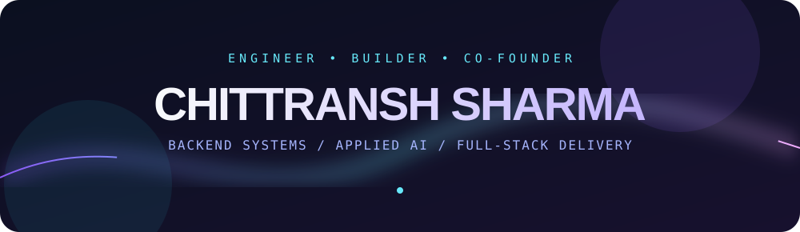
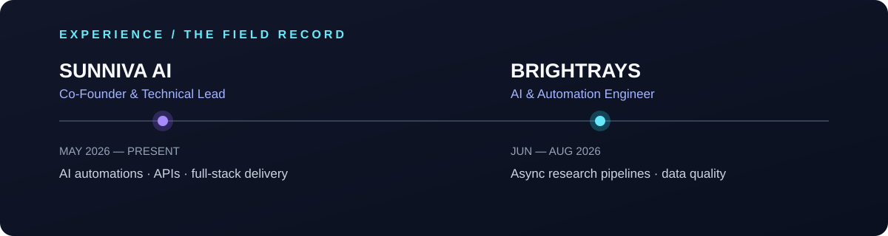
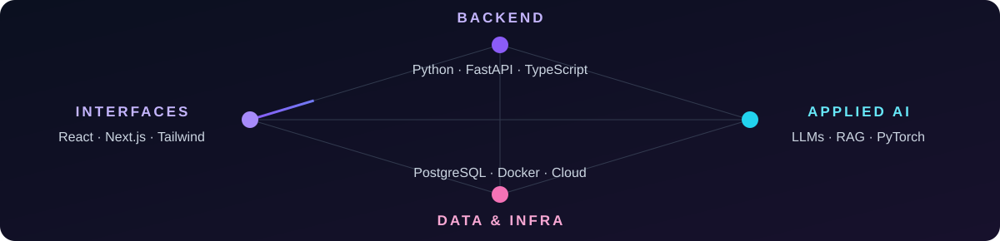

  
    
  
  
  

 

### I build what happens after the demo.

I’m **Chittransh Sharma** — a backend and applied AI engineer, and **Co-Founder & Technical Lead at Sunniva AI**. My work lives where systems meet the real world: asynchronous pipelines, APIs, real-time media, data infrastructure, and AI workflows that need to keep working when the happy path ends.

<b>Inside the work ↗</b>

**Sunniva AI · Co-Founder & Technical Lead · May 2026 — Present**  
Own technical discovery, architecture, integration design, deployment, debugging, and client handoff. Build AI automations and full-stack products across backend APIs, React/Next.js, TypeScript, PostgreSQL/Supabase, and LLM services. Connect webhooks, CRM, WhatsApp, and voice systems.

**Brightrays · AI & Automation Engineer · Jun — Aug 2026**  
Built asynchronous Python research pipelines with Playwright, HTTPX, and local LLMs. Turned manual collection into retryable extraction, validation, deduplication, and enrichment workflows with structured logging, fault recovery, and Excel/JSON outputs.

 

### The stack behind the spectacle.

**Backend** · Python · FastAPI · Node.js · TypeScript · AsyncIO · REST · WebSockets · WebRTC · SSE · SQLAlchemy · Alembic · Pydantic · HTTPX  
**Applied AI** · LangGraph · LangChain · RAG · LLM orchestration · PyTorch · scikit-learn · Ollama · faster-whisper  
**Data & infrastructure** · PostgreSQL · Supabase · Neo4j · MongoDB · SQLite · Docker · Linux · AWS · Azure · GitHub Actions  
**Interfaces & quality** · React · Next.js · Vite · Tailwind CSS · Playwright · Pytest · Vitest

 

  
   
  <a href="mailto:chittranshsharma150@gmail.com"><b>Have an ambitious problem? Let’s build.</b></a>

